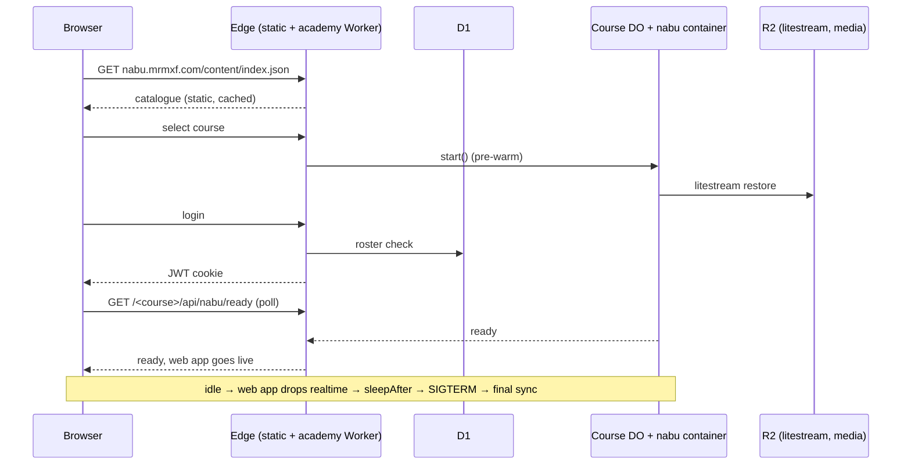

# Plan: Nabu as SaaS on Cloudflare, and the academy

**Mode:** canonical SaaS on Cloudflare. The classroom-laptop mode is covered in
[claude-deploy.md][deploy] and does not need any of this. A help lesson explaining the
choice is planned (`help/using-nabu/reference/05-deployment-modes.md`, not yet in this
repo; backlog M-10).

**Status:** design, not built. Moved here on 2026-11-14 from the original split plan.
The decided parts that already have a home (the deployment-mode table, hosts and routes,
delivering the web app) live in [claude-deploy.md][deploy]; this file holds the parts
that had no other home: the target flow, the academy contracts and the build step.

> **Hosts were revised on 2026-11-12.** nabu owns no routes on `mrmxf.com`. Courses
> live at `https://nabu.mrmxf.com/<course>/…`, and the menu at `mrmxf.com/learn/` is
> drawn in the browser from `https://nabu.mrmxf.com/content/index.json`. The paths
> below follow that revision; see "Hosts and routes" in [claude-deploy.md][deploy].

Words such as course, lesson, session, group and attempt have the meanings in the
[glossary][glossary].

## Target flow: who does what

**Main idea:** split the system into three tiers by how often each one runs.

1. **Static tier:** the catalogue, lesson content and the web app. Served from a CDN,
   so it is instant and free when idle.
2. **Control plane:** identity, roster, catalogue API and the waker for course
   containers. Tiny and serverless.
3. **Workload tier:** one nabu container per course, holding the course's state
   (PocketBase), the dynamic lesson components and job dispatch. It scales to zero, and
   Litestream replicates its database to R2/S3.

Because identity lives in the control plane, the user logs in **while** the container
boots, not after it.

### Scenario walk-through (Cloudflare shape)

| # | What the user sees | Static tier | Control plane: academy Worker + D1 | Course container (Durable Object + nabu) |
|---|---|---|---|---|
| 1 | Lands on `mrmxf.com/learn/` | www-mrmxf's Hugo page, served from the edge cache | nothing | asleep |
| 2 | Sees the course list | An inline script reads `nabu.mrmxf.com/content/index.json` (CORS `*`) | Later: the academy also returns the user's resume pointers from D1 ("continue `<course>`, slide 4") | asleep |
| 3 | Picks a course and logs in | The web app and `lesson.json` load from `nabu.mrmxf.com/<course>/`; content is readable at once | On select, the Worker calls the course Durable Object's `start()` (pre-warm). Login is checked against the D1 roster or SSO. It issues a short-lived signed JWT (Ed25519) cookie, host-only on `nabu.mrmxf.com`, with enrolment claims | Boots: litestream restore → migrate → content-hash check (seed only if content changed) → serve. Reports its boot phase |
| 3b | "Getting your workspace ready…" disappears | The web app polls `/<course>/api/nabu/ready`, or uses SSE | The Worker holds `/<course>/api/*` until the Durable Object reports ready | Verifies the academy JWT against the academy's public key (JWKS), then maps it just in time to a local PocketBase user and enrolment |
| 4 | Coursework, then dinner | After N minutes without input, or when the tab is hidden, the web app **closes its realtime and Yjs connections**. An open SSE stream would otherwise keep the container awake all night | Receives signed progress batches from the course outbox and updates the resume pointer in D1 (de-duplicated by `event_id`) | Litestream ships changes every few seconds. After `sleepAfter` (e.g. 15 min) with no requests the container gets SIGTERM, runs a final litestream sync, and exits |
| 5 | Returns: "Restoring your session…" | Shows the last slide **read-only** at once, from the resume pointer plus the static `lesson.json` | Sees the Durable Object is cold and wakes it; the user is still logged in via the cookie | Cold start, as in step 3 |
| 6 | Carries on | Live features resume. Edits buffered offline in Yjs (y-indexeddb) sync up | nothing | Ready. Agent jobs dispatch to the remote worker host |

### Where each piece of logic lives

| Concern | Owner | Why |
|---|---|---|
| Course catalogue, course registry | static `content/index.json`, later also the academy (D1) | It has to answer while every container is asleep |
| Login, SSO, main roster, course enrolment | academy (D1). It issues the JWT; nabu trusts it | Login can't wait on a cold start, and one identity spans courses |
| Lesson content (slides, images) | static, from `nabu build` | Readable without a container |
| Bulky media | R2/S3, proxied by the Worker at `/content/<course>/<lesson>/media/*` | No container needed |
| Session windows, groups, attempts, Yjs, quizzes, jobs, quotas | nabu container (PocketBase) | Dynamic, per course, and existing code |
| Resume pointer | nabu is authoritative; the academy holds a cheap copy | The "you were here" screen appears before the container is ready |
| Wake, sleep, readiness gating | academy Worker + course Durable Object | Container lifecycle is a platform concern |
| Agent execution | a remote worker host; nabu dispatches | GPU and model work stays out of the course container |

### Should there be an academy layer?

**Yes, but thin and edge-native, not another container.** A container acting as host
would itself need waking, which defeats scale-to-zero.

The academy is:

- a Worker (`www-nabu-academy`, custom domain `nabu.mrmxf.com`)
- D1 tables: `courses`, `users`, `enrolments`, `resume`, `auth_keys`
- a published course manifest contract

Courses plug in by registering a manifest from CI. The manifest holds the slug,
version, static base, container image or binding, readiness path and required claims.

**What makes it light:**

- Most of a lesson is static once `nabu build` has run, so a container is only needed
  for the active components.
- The Worker pre-warms on course selection, so boot overlaps with login.

**Alternatives considered:**

- *One multi-tenant nabu for all courses:* simpler, but always on, and every course is
  tied to one schema and release.
- *A container per user:* best isolation, but it breaks groups and multiplies cold starts.

**Engine changes this implies:**

- **Base-path support:** the web app and API must work under `/<course>/`. That means
  SvelteKit `paths.base`, the PocketBase SDK base URL, and asset and cross-reference
  rewriting.
- **Trusted-issuer auth:** add `auth.trusted_issuers` (JWKS URL plus audience), with
  just-in-time user and enrolment mapping. Native PocketBase login stays for standalone
  and classroom use.
- **Boot phases and readiness:** `restoring` → `migrating` → `seeding` → `ready` at
  `/api/nabu/ready`. Seeding is skipped when the content hash is unchanged.
- **Idle-aware web app:** drop realtime on idle or a hidden tab, show a read-only
  "restoring" mode, and buffer Yjs edits offline.
- **Graceful SIGTERM:** a final litestream sync. Confirm Cloudflare's grace period
  before relying on it.
- **Resume webhook:** a best-effort POST of the resume pointer to the academy.

### The same shape on other hosts

The portable pattern is **static shell + thin control plane + on-demand workload**,
joined by three small HTTP contracts:

- **Course manifest:** JSON registered with the control plane.
- **Control-plane API:** `GET /courses`, `POST /courses/:slug/wake` returning
  `{state: cold|starting|ready, eta_s}`, `GET /courses/:slug/status`,
  `/.well-known/jwks.json` and login.
- **nabu container contract:** `/api/nabu/ready`, trusted-issuer JWT, SIGTERM flush,
  and state replicated to S3-compatible storage.

The web app's waiting room only talks to these contracts, so it is identical everywhere.

| Host | Static tier | Control plane | Workload tier (scale to zero) |
|---|---|---|---|
| Cloudflare (first) | Workers static assets or Pages | Worker + D1 | Containers via Durable Objects, `sleepAfter` |
| GitHub / GitLab Pages | Pages | **none on Pages:** use a Cloudflare Worker anyway, or a tiny VPS | wherever the control plane lives |
| Linode / any VPS | Caddy | a `nabu academy` Go subcommand (SQLite) on one small VM | podman with systemd socket activation: wakes on the first request, stops when idle |
| AWS | S3 + CloudFront | Lambda function URL + DynamoDB | ECS Fargate `RunTask`; slow (30–60 s) cold start, so pre-warming matters more. App Runner is the alternative |
| Fly.io | Fly static or any CDN | small always-on app | Machines with auto-stop and auto-start (fast cold start) |

**Recommendation:**

- Implement the control plane twice against one written contract: a TypeScript Worker
  for Cloudflare, and `nabu academy` in Go for VPS or AWS-style hosts.
- Build the Cloudflare one first and keep the contract in `academy/contract/`, so the
  other hosts are adapters, not redesigns.
- Browsing stays fast everywhere because it never touches the workload tier. The heavy
  lifting only starts on selection, overlapping with login.

## Academy: contracts, roster and sync

### Decisions

- **Location:** the academy lives in this repo under `academy/` (not yet in this repo).
  Every contract is defined once in `academy/contract/` and used by both sides.
- **Main roster:** in D1, with personal fields encrypted at the application layer and
  keys from Infisical. nabu asks a configured academy for the roster and falls back to
  a local copy.
- **Spawning:** the academy spawns course containers. A standalone container uses the
  **identical** spawn data structure, read from a local file.
- **Progress:** always saved locally first, in the course container. The academy copy
  is derived, so an academy outage never loses work.

### Contracts, defined once

`academy/contract/` holds JSON Schemas as the single source of truth. Go types
(`academy/contract/go`, imported by nabu) and TypeScript types (for the Worker) are
generated from them. CI fails if the generated code drifts from the schemas.

| Contract | Direction | Content |
|---|---|---|
| `course-manifest` | course CI → academy | slug, version, static base, image or binding, readiness path, course public key (`kid`), required claims |
| `spawn-spec` | academy → container, **or a local file when standalone** | course slug and version; `academy: {url, jwks_url} \| null`; `roster: {source: academy\|file, path?}`; `state: {litestream replica url}`; `progress: {push_url?}`; secret **references**, never values |
| `roster` | academy → course (pull), **or a local file** | an envelope of `{uid, display_name, role, courses[]}` with a version cursor, signed as a JWS. It is a superset of today's `users:` envelope, so `internal/students` keeps decoding local YAML. A local file may be unsigned |
| `progress-event` | course → academy (push) | a batch of `{event_id (ULID), seq, uid, lesson, session, attempt, slide, state, at}`, signed with the course key |
| `auth-token` | academy → browser → course | JWT profile: `sub=uid`, `aud=course slug`, roles and enrolment claims, short expiry, `kid` |
| `control-plane API` | browser and course ↔ academy | OpenAPI: `GET /courses`, `POST /courses/:slug/wake`, `GET /courses/:slug/status`, login, `GET /courses/:slug/roster?since=`, `POST /courses/:slug/progress`, `/.well-known/jwks.json` |
| `container` | academy ↔ container | `/api/nabu/ready` boot phases, SIGTERM flush, idle behaviour |

**Standalone mode.** `nabu serve --spawn spawn.json` takes the same `spawn-spec` with
`academy: null` and `roster.source: file`.

- Auth falls back to native PocketBase login.
- The roster comes from the local file, in the same `roster` format.
- Progress is local only; `push_url` is unset.

Under the academy, only the field values differ. That keeps one code path in nabu.

### Main roster in D1

- **Encryption:**
  - Columns are `uid`, `role`, enrolments, `email_bidx`, `email_enc`, `name_enc`, `kid`.
  - Email and name are encrypted with AES-256-GCM in the Worker (WebCrypto).
  - Lookup uses a blind index, `email_bidx = HMAC-SHA256(normalised email)`, with a
    separate key.
  - D1 is already encrypted at rest. This extra layer protects against dumps, console
    access and backups.
  - The cost: no SQL search on names, and admin views decrypt inside the Worker.
- **Keys:**
  - Infisical holds the roster encryption key, the blind-index key, the academy Ed25519
    signing key and each course signing key, all versioned by `kid` for rotation.
  - They reach the Worker as secrets through Infisical's Cloudflare sync. Check that
    integration works; otherwise a CI step runs `wrangler secret put` from
    `infisical export`.
  - The academy passes a course's key to its container when it spawns it.
- **Data minimisation:** course containers get only `uid`, display name, role and
  courses. Emails and passwords never leave the academy.

### nabu side (engine work)

- **`internal/academy` client** (not yet in this repo). It reads the `spawn-spec` and:
  - pulls the roster, verifying the JWS against the cached JWKS
  - upserts it into PocketBase as a local cache
  - falls back to the last good cache, then to the local roster file
  - logs `slog.Warn` when running on a stale roster
- **Progress outbox.** Every progress change is written locally to PocketBase, which
  Litestream replicates, and appended to an `outbox` table in the same transaction.
  - A background pusher sends signed batches with backoff.
  - Delivery is at least once, and the academy de-duplicates by `event_id`.
  - The outbox is drained on SIGTERM if the academy is reachable; otherwise it waits
    for the next boot.
- **Academy outage:**
  - Signed-in users carry on: the JWT is verified locally against cached keys, and the
    course issues its own PocketBase session after the first check.
  - New logins fail with a clear message, except local break-glass accounts (a superuser
    or a teacher from the local roster).
  - Nothing is lost.

### Transactional dialogue or lightweight cryptographic sync?

**Decision: lightweight cryptographic sync.** That means signed, idempotent,
single-writer documents with cursors, and no transactions that span the academy and a
course.

- **Every piece of data has exactly one writer.**
  - The roster and enrolment are written by the academy and read by courses.
  - Progress and the resume pointer are written by the course and read by the academy.
  - With one writer there are no conflicts to resolve, so nothing needs to be
    transactional.
- **Either side may be asleep or down.**
  - A course scales to zero, and the academy can have outages.
  - A transactional dialogue needs both up at once. That would put academy latency on
    every slide advance and tie their failures together, which contradicts "always save
    locally".
- **Signatures give integrity without a live session.**
  - A roster snapshot or a progress batch can be checked offline, cached and retried,
    and replayed safely because messages are idempotent by `event_id`, `seq` or cursor.
  - It is the same Ed25519/JWS machinery as the login tokens: one mechanism, one set of
    keys.
- **What stays transactional:** anything needing agreement inside one side, such as
  seat limits, payments or enrolment, is a D1 transaction within the academy, never a
  cross-system one.
- **Cost:** ordering, de-duplication by `event_id`, cursor pagination for roster deltas,
  and handling key rotation by `kid`. All of it is small and testable.

The resume pointer comes only from the course outbox; the Worker never writes it.

## Build steps

### Near term (2026-11-14)

**Step 1 (static) done 2026-11-15** with a fresh `nabu init` course, fvp-portfolio
(nabu-tutorial does not exist yet): Pages projects `nabu-<course>-staging` (push to
main) and `nabu-<course>` (v* tag), secrets from Infisical folder `/course-<course>`
in project nabu, CI logging in by OIDC with exact-id subjects. Verified live: JSON
content types, the `_headers` CORS rule, SPA fallback for deep links, the guest
lesson. Found M-18 (home/login hang with no server) and C-07. The naming went back
into the `nabu init` templates. Still to do in step 1: the `mrmxf.com/learn/` menu.

**Academy-lite (2026-11-15), ahead of the academy.** For a first live course before
the academy exists: one Nabu container per course behind a Worker on its own host
(`nabu-<course>-course`, Container Durable Object), Litestream to an R2 bucket
`nabu-<course>-state`, student work in `nabu-<course>-work`, and sign-in by emailed
code (`/api/auth/otp`, mail through a provider API, `internal/mail`) against an
imported roster (Worker secret `NABU_ROSTER_CSV`). The academy later replaces the
roster secret and the code login with its JWT; the container stays the same.

1. Static `nabu build` to a preview Pages project; then switch on the
   `mrmxf.com/learn/` menu script in www-mrmxf. `nabu build` already writes the
   `_headers` rule giving `/content/index.json` `Access-Control-Allow-Origin: *`
   (2026-11-14).
2. R2 media through a Worker proxy at `/content/<course>/<lesson>/media/*`.
3. A local podman container with Litestream to R2.
4. Worker + Container Durable Object, with `nabu.mrmxf.com` as its custom domain.
5. `clog CI probe` against the live deploy.

### Cloudflare template and academy

- Build the engine changes listed under "Should there be an academy layer?": base path,
  trusted-issuer auth, readiness phases, idle-aware web app, SIGTERM flush and the
  resume webhook.
- Write `academy/contract/` (schemas, Go and TS code generation, drift check), then
  `internal/academy` (roster client and progress outbox), then `nabu serve --spawn`.
- Build the academy Worker + D1 under `academy/worker/`, with the encrypted roster,
  JWKS, wake, progress ingest and catalogue, on `nabu.mrmxf.com`.
- Check that standalone (`--spawn` with `academy: null`) and academy-spawned containers
  run from the same image.
- Outage test: block the academy mid-lesson. Progress keeps saving, the outbox drains
  on recovery, and there are no duplicate events in D1.
- `deploy/cloudflare/`: the static tier serves the `nabu build` output.
- A Worker on `/<course>/api/*`, `/<course>/_/` and `/content/*/*/media/*` routes
  requests to one Container Durable Object per course (key = course slug), with
  Litestream to R2.
- CI deploys with `git lfs pull && nabu build && wrangler pages deploy`.

### Verification

A preview deploy on Cloudflare: cold start, log in, run a job, let it sleep, wake it,
and confirm state is kept.

## Open items

- Whether Cloudflare Containers support FUSE for an S3 mount. If not, media goes through
  the Worker proxy only.
- Cloudflare's SIGTERM grace period, before relying on the final litestream sync.
- Whether Infisical's Cloudflare secret sync is good enough, or CI must run
  `wrangler secret put`.

[deploy]: ../claude-deploy.md
[glossary]: glossary.md
