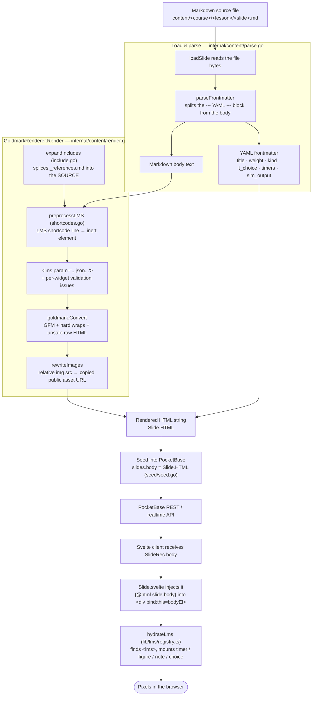

Every slide you author is just a Markdown file on disk. This page follows one
slide the whole way to the screen, using Nabu's **internal renderer** (the pure-Go
Goldmark path — the default demo path). The alternative Hugo renderer is wired but
not implemented yet, so it is out of scope here.

## The pipeline at a glance

## Step by step

1. **Source file.** A slide lives as `<NN>-<slug>.md` inside a lesson folder, or as
   `index.md` in a leaf-bundle folder (so it can carry its own images). This is the
   only thing an author edits.

2. **Read & split frontmatter** — [`parse.go`](../../../internal/content/parse.go).
   `loadSlide` reads the file, then `parseFrontmatter` separates the top `--- … ---`
   YAML block from the Markdown body. The YAML becomes typed slide config (title,
   weight, `kind`, `choices`, `timers`, `sim_output`, readiness…); the body carries on
   to the renderer. A file with no frontmatter is treated as body-only; an
   unparseable one is flagged `CORRUPT` rather than aborting the whole load.

3. **Expand includes** — [`include.go`](../../../internal/content/include.go).
   `` is resolved **first**, before
   anything else looks at the text: the named file is spliced into the source, so
   from here on it is indistinguishable from text the author typed.

   The ordering is the whole point. Markdown link reference definitions
   (`[zapier]: https://zapier.com`) only resolve *within a single document*, so a
   slide writing `[Zapier][zapier]` needs the definitions in its own source before
   conversion. Move this step after Goldmark and reference-style links silently
   stop resolving. Includes don't nest — an included file is spliced verbatim and
   never rescanned — so cycles are impossible by construction.

4. **Preprocess LMS shortcodes** — [`shortcodes.go`](../../../internal/content/shortcodes.go).
   Before any Markdown is touched, each `` line (on its own line) is
   rewritten into an **inert** `<lms param='…'>` element that carries an HTML-escaped
   JSON payload of its arguments. Arguments are validated against `nabu-widget-catalogue.yaml` (the
   single source of truth); unknown widgets or bad args don't block rendering — they
   are recorded as issues that set the slide's content status.

5. **Markdown → HTML** — [`render.go`](../../../internal/content/render.go).
   `goldmark.Convert` turns the body into HTML. It is configured to match the old
   client-side `marked` behaviour: **GFM** (tables, strikethrough, autolinks) plus
   **hard line breaks**, and **unsafe raw HTML passes through** — necessary so the
   `<lms>` elements and any author-written inline HTML survive. Content is trusted
   (teacher-authored), so this is safe.

6. **Rewrite images.** `rewriteImages` finds every `` with a
   bundle-relative source, copies that file into the served public tree, and points
   the `src` at its new public URL. Absolute (`/…`), remote (`http(s)://`), and
   `data:` sources are left untouched. A missing image becomes a warning, not a
   failure.

7. **Store the HTML.** The result is a plain HTML string on `Slide.HTML`. During
   seeding ([`seed.go`](../../../internal/seed/seed.go)) it is written to the
   `body` field of the slide record in **PocketBase**. The Markdown is now fully
   rendered; from here on the server only ships HTML.

8. **Serve to the client.** The Svelte UI reads the slide record over PocketBase's
   REST/realtime API. The pre-rendered HTML arrives as `SlideRec.body` — no Markdown
   parsing happens in the browser.

9. **Inject** — [`Slide.svelte`](../../../web/src/lib/components/Slide.svelte).
   The component drops the HTML in with `{@html slide.body}` inside a bound
   `
`. At this point the inert `<lms>` placeholders are sitting in the DOM,
   doing nothing yet.

10. **Hydrate widgets** — [`registry.ts`](../../../web/src/lib/lms/registry.ts).
   `hydrateLms` walks the injected DOM, finds each `<lms>` element, parses its JSON
   payload, and mounts the matching Svelte component (`timer` → `CountdownTimer`,
   `figure` → `LmsFigure`, `note` → `LmsNote`) into it. The registry keys must match
   the widget types in `nabu-widget-catalogue.yaml`. Unknown widgets are left inert.

11. **Pixels.** The browser paints the hydrated HTML. The slide the student sees is
    the round-trip of the file an author saved.

## Where forms and buttons come in

Two kinds of interactive elements ride along this pipeline, and it's worth knowing
which is which:

- **Inline widgets** are placed *inside the Markdown body* with an ``
  shortcode, so they flow through steps 3–10 above and land exactly where the author
  wrote them. This includes the **choice** selector: the options live in
  `t_choice` frontmatter, but a `` widget positions
  them in the body. During hydration (step 10) `hydrateLms` resolves the `id`
  against the slide's `t_choice` groups and mounts the selector there.
- **Declarative widgets** — the agent screen (`kind: agent`) and the notes textarea
  (`notes_label`) — are **not** part of the body HTML. They come from frontmatter
  and are rendered by `Slide.svelte` *around* the body. That's why you won't find a
  shortcode for them in the source: their position is fixed by the component, not by
  where you type in the Markdown.

## Scope note

This page covers only the internal Goldmark renderer. The Hugo-backed renderer
(`HugoRenderer` in `render.go`) shares the same `Renderer` interface and the same
`nabu-widget-catalogue.yaml` widget contract, but is not yet implemented — when it lands it will slot
in at steps 4–6 in place of the Goldmark path.
