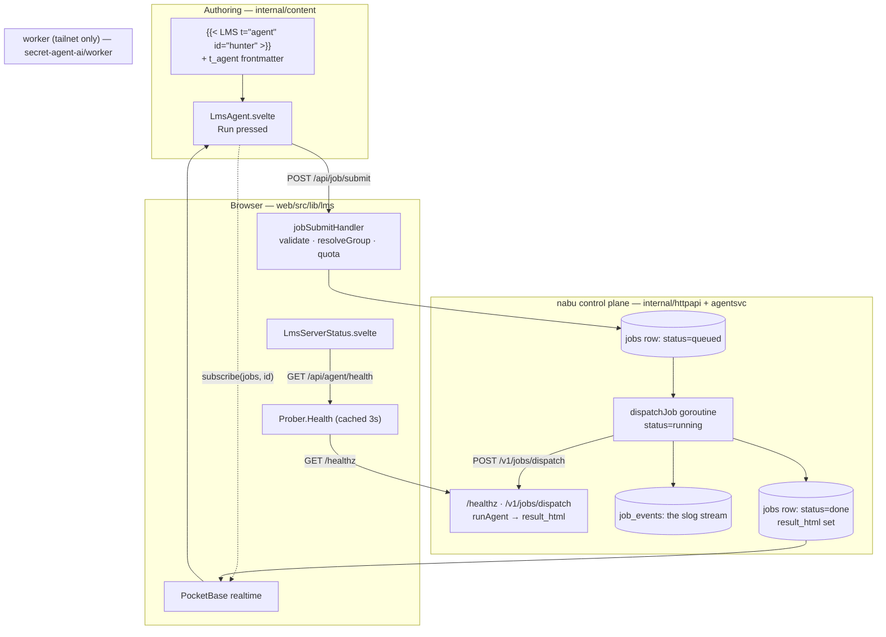

This page is the **single source of truth for the agent pipeline** — the pipes
between a user and the AI. Everything else (the spec drafts under `docs/`, the
widget catalogue, the migrations) implements what is described here; where they
disagree, this page wins.

## How to read this (two audiences)

- **A future Claude Code session.** Every stage below is anchored to the file that
  owns it. Treat the *contracts* section as normative: the collections, the two
  nabu endpoints, and the two worker endpoints are the whole interface. Don't
  reinvent them — extend them.
- **A developer extending an agent, or porting the backend.** Two sections are for
  you: **Extending an agent** and **Porting the backend (self-hosted → AWS
  Bedrock)**. The one thing to internalise first is the responsibility split: nabu
  owns identity, the jobs table, and quotas; the worker is identity-free and only
  runs a job and reports capacity. That split is what makes the backend swappable.

## The one invariant

> **nabu never talks to a model. It only talks to a *worker* over HTTP.**
> The model (local GPU, an API, or Bedrock) lives entirely behind the worker's two
> endpoints. Swap the worker and you swap the AI; the rest of the system does not
> change.

## The flow at a glance



## The contracts (normative)

### 1. Authoring — how a lesson asks for a job

An agent job is placed in a slide body by an inline widget and configured in
frontmatter, mirroring the `choice` widget. Catalogue:
[`nabu-widget-catalogue.yaml`](../../../internal/content/nabu-widget-catalogue.yaml); Go model:
[`model.go`](../../../internal/content/model.go) (`AgentJob`); parsing:
[`parse.go`](../../../internal/content/parse.go).

```yaml
params:
  t_agent:
    - id: hunter               # shortcode ref + work_state key + job step name
      agent: web_search        # the worker-advertised tool to run
      title: "Run hunter"
      timeout: "60s"
      sim_output_fallback: true # show the slide's sim_output if the worker is offline
      inputs:                  # payload sent to the worker; {{choice:ID}} / {{field:ID}}
        query: "{{choice:human-topic}} — key facts"
        max_results: 5
```

```text
        # dispatches the job here
             # health + the student's group tag
```

### 2. nabu HTTP surface — [`routes.go`](../../../internal/httpapi/routes.go)

- **`POST /api/job/submit`** — [`jobs.go`](../../../internal/httpapi/jobs.go). Auth
  required. Body: `{ session_id, slide, agent_id, agent, inputs, timeout }`.
  - `200 { job: { id, status, queue_pos } }` on accept.
  - `503 { error: "server_unreachable" }` — worker health is red.
  - `400 { error: "agent_unavailable", agent }` — agent not advertised by the worker.
  - `429 { error: "queue_full", group_active, group_max }` — per-group cap hit.
  - `423 { error: "submissions_paused" }` — group paused.
  - `403 / 404` — session not the caller's / not found.
- **`GET /api/agent/health`** — [`agent.go`](../../../internal/httpapi/agent.go). Auth
  required. Returns nabu's cached view of the worker (always `200`; an offline
  worker is `alive:false`, not an error):
  `{ alive, uptime_s, version, capacity, running, queue_depth, agents[], reason, checked_at }`.

### 3. Worker HTTP surface — [`worker/main.go`](../../../cmd/nabu-worker/main.go)

Tailnet-only, no public port. This is the **entire** model-facing interface.

- **`GET /healthz`** → `{ alive, uptime_s, version, capacity, running, queue_depth, agents[] }`.
  `agents[]` is the presence contract: nabu asserts every agent a live lesson uses
  appears here.
- **`POST /v1/jobs/dispatch`** →
  request `{ job_id, agent, inputs }` → response `{ result_html, error }`.
  Currently **synchronous**: the worker runs the job and returns the result in the
  same response. (The async variant — worker calls back to
  `/v1/jobs/:id/{complete,fail,log}` — is reserved for long jobs and not built yet.)

The Go types for the dispatch contract live in
[`agentsvc.go`](../../../internal/agentsvc/agentsvc.go) (`DispatchRequest`,
`DispatchResult`) — this is the seam a Bedrock backend implements.

### 4. Data model — [`1751000006_agent_jobs.go`](../../../migrations/1751000006_agent_jobs.go)

nabu owns all of it; students only ever *read* their own rows (jobs/artifacts are
server-written).

- **`groups`** — `tag` (sXgY, unique) · `course` · `max_depth` · `paused` · timestamps.
  The quota bucket; auto-created on first submit (`resolveGroup`).
- **`jobs`** — `request_id` · `student` · `group` · `session` · `course` · `lesson`
  · `slide` · `agent` · `inputs` · `timeout_s` · `status` (queued|running|done|failed)
  · `queue_pos` · `worker` · `result_html` · `error` · `retries` · `created` ·
  `dispatched_at` · `completed_at`.
- **`job_events`** — `job` · `level` · `event` · `msg` · `fields` · `created`. The
  slog stream, surfaced to the widget and (later) the teacher dashboard.
- **`artifacts`** — `job` · `student` · `kind` (html|json|pdf) · `title` · `file`.
  The take-home output. **v0 stores the result inline on `jobs.result_html`; the
  artifacts row is not yet written** (see the Yjs note — the artifact layer is where
  collaboration lands).

### 5. Configuration

- `WORKER_HEALTH_URL` — e.g. `http://127.0.0.1:8091/healthz` (local) or
  `http://sa-worker:8091/healthz` (tailnet).
- `WORKER_DISPATCH_URL` — optional; defaults to the health URL with `/healthz`
  swapped for `/v1/jobs/dispatch`.

## Step by step

1. **Author** places `` in a slide and a `t_agent` entry
   in frontmatter. At hydrate time [`registry.ts`](../../../web/src/lib/lms/registry.ts)
   resolves the id to the config and mounts
   [`LmsAgent.svelte`](../../../web/src/lib/lms/LmsAgent.svelte); the host threads in
   the session id, slide, and group tag via
   [`Slide.svelte`](../../../web/src/lib/components/Slide.svelte).
2. **Readiness.** The widget calls `getAgentHealth`
   ([`health.ts`](../../../web/src/lib/lms/health.ts)); if the worker is down or the
   agent isn't advertised, it shows the offline state (and the sample, if
   `sim_output_fallback`). `serverstatus` shows the same health plus the group tag.
3. **Submit.** Run → `POST /api/job/submit`. `jobSubmitHandler` checks auth, worker
   health, agent presence, and session ownership; `resolveGroup` finds/creates the
   `sXgY` group; the quota is `count(jobs where group AND status in queued,running)`
   vs `max_depth`. Over cap ⇒ `429 queue_full`.
4. **Record.** A `jobs` row is written `status=queued`; a `job_events` `queued` row
   is appended; `200 { job }` returns immediately.
5. **Dispatch.** `dispatchJob` runs in a background goroutine (request-independent
   context): sets `status=running`, then `Prober.Dispatch` POSTs the worker's
   `/v1/jobs/dispatch`.
6. **Run.** The worker's `runAgent`
   ([`worker/main.go`](../../../cmd/nabu-worker/main.go)) produces the
   result and returns `{ result_html }`. (Today canned-but-realistic; this is the
   only function a real model replaces.)
7. **Complete.** nabu writes `status=done` + `result_html` (or `failed` + `error`)
   and a terminal `job_events` row.
8. **Round-trip.** The widget subscribed to its `jobs` record over PocketBase
   realtime; the status change arrives and it renders the real `result_html`. A
   `getOne` reconcile covers a job that finishes before the subscription lands.

## Extending an agent (for a developer)

Adding an agent is deliberately small — it does **not** touch nabu:

1. **Advertise it** in the worker's `agents` list and add a branch to `runAgent`
   ([`worker/main.go`](../../../cmd/nabu-worker/main.go)). The name you add
   is the `agent:` value lessons will use.
2. **Author** a `t_agent` entry with `agent: <your-name>` and place a
   `` widget.
3. That's it. Presence (`/healthz` `agents[]`), the queue, quotas, realtime, and the
   widget all work unchanged. nabu validates the agent is advertised before it
   dispatches, so a typo fails fast with `agent_unavailable`.

Hardening still owed (note for later): nabu currently trusts client-sent `agent` +
`inputs`. The intended fix is to validate them server-side against the slide's
`t_agent` config rather than the request body.

## Porting the backend (self-hosted → AWS Bedrock)

The port boundary is exactly the **`DispatchRequest` → `DispatchResult`** contract
plus **`/healthz`**. Everything above it (jobs, quotas, `job_events`, realtime, the
widget) is provider-agnostic and stays. Two strategies:

**A. Keep the worker; point it at Bedrock (smallest change).**
Replace `runAgent` with a Bedrock call (`bedrock-runtime:InvokeModel`, or a Bedrock
Agent runtime). The tailnet worker stays as the process that holds AWS credentials
and turns a `{agent, inputs}` into `result_html`. nabu is untouched. `agents[]` in
`/healthz` becomes the set of Bedrock models/agents you expose.

**B. Replace the HTTP hop; nabu calls Bedrock directly (no self-hosted worker).**
Introduce a small `Dispatcher` interface in
[`agentsvc.go`](../../../internal/agentsvc/agentsvc.go) with one method
(`Dispatch(ctx, DispatchRequest) (DispatchResult, error)`), give it two
implementations — the current `httpWorker` and a new `bedrock` — and select via env
(e.g. `DISPATCH_BACKEND=http|bedrock`). This is the one enabling refactor: today
`Dispatch` is a concrete method on `Prober`; extract the interface and the Bedrock
backend is a drop-in.

Whichever you pick, mind the seams that differ from the tailnet worker:

- **Auth.** Tailnet trust (device identity on a private net) becomes **AWS IAM /
  SigV4** on the Bedrock calls. nabu→worker had no per-call auth; nabu→Bedrock needs
  a credential chain.
- **Health.** Bedrock has no `/healthz`. Synthesize one: a cheap reachability check
  (e.g. `ListFoundationModels`, cached like `Prober.Health`) mapped into the same
  `Health` shape so `serverstatus` and the offline banner keep working.
- **Latency & timeouts.** `dispatchTimeout` (90s) is generous for the canned worker;
  size it to real model latency and consider the async callback variant (§3) for
  long generations so a request goroutine isn't held open.
- **Cost/quotas.** Per-group `max_depth` already throttles concurrency; that's your
  first cost lever when a model call has real spend behind it.

## Forward-looking: collaborative outputs & Yjs

**Assumption to carry:** every agent output is ultimately a *collaborative document*
— group members and AI agents both contribute to it — and **Yjs (a CRDT) is the
intended stored/sync substrate** for those documents.

**Verdict: name it now, build it later.** It is relevant to the *artifact/output
boundary*, not to the *pipe*. The submit → queue → dispatch → health machinery above
is unaffected by how outputs are stored, so pulling Yjs in now would be premature.
What matters today is one design constraint so we don't build something we must tear
out:

> Treat `jobs.result_html` as a **v0 placeholder for a document contribution**, not
> as a permanent, single-owner terminal artifact. Keep the job→output boundary thin.

When collaboration lands (alongside working agents + the teacher dashboard), the
shape it plugs into is already visible here:

- The **`artifacts`** collection becomes (or gives way to) a **Yjs document store**
  (the CRDT update log + a snapshot), owned by the group rather than one student.
- A job gains a **target**: `{ document_id, region/block, intent: replace|append|suggest }`.
  An agent then *contributes to a region* of a shared doc instead of returning a
  standalone blob — `DispatchResult` carries a structured contribution, not just
  HTML.
- Agent contributions become **suggestions/edits** in the same CRDT humans edit, so
  provenance ("who wrote this — a person or hattie?") and awareness/presence come for
  free from Yjs.
- The teacher dashboard reads the same documents live.

Until then, this doc describes the real, working pipe. Revisit this section when we
implement collaboration; the contracts in §1–§5 should still hold.

## Scope note

This page reflects the **current** implementation: synchronous worker dispatch,
inline `result_html`, naive `queue_pos`, no artifact rows yet, and a canned
`runAgent`. Items marked "not yet"/"v0" (async callbacks, the artifacts/Yjs layer,
server-side input validation, the teacher dashboard) are planned in
`docs/phase3-tracking-spec.md`; the local
and remote bring-up is in
`docs/phase3-health-test-plan.md`.
