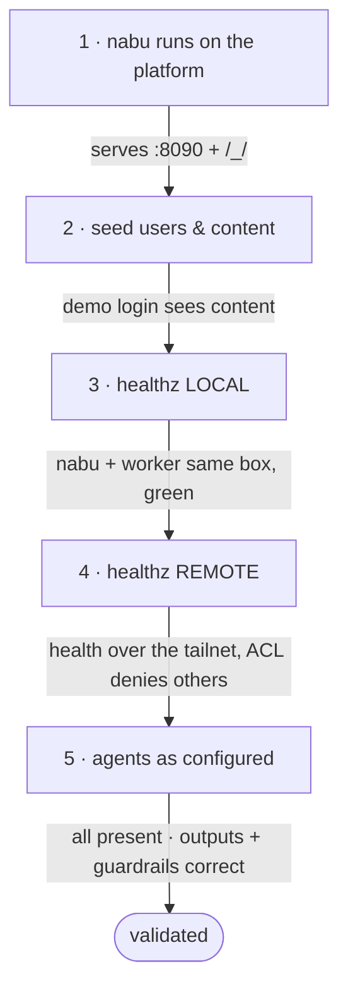

This is the **bring-up runbook**: the exact sequence to start Secret Agents and
prove each layer before trusting the next. It's written for the operator (Bruce
today, the ops team later). The rule is **gates** — every step ends with a pass
condition; a red gate stops you here and points at
[troubleshooting](help:reference#troubleshooting-agents). For the architecture behind it,
see [agent fundamentals](help:reference#agent-fundamentals).

For the *data* side of first-time bring-up — the config/env readiness gate
(`nabu admin validate`), seeding, roster install, and backup/restore onto a target
— see [admin cold start](help:reference#admin-cold-start). Run `nabu admin validate`
before gate 1 below: it fast-fails on a missing env var, unwriteable `pb_data`, or
absent superuser, so you don't discover those at runtime.

## Prerequisites

Install these before gate 1, on the box that runs each component. The local gates
(1–3) run entirely on one machine; the tailnet (4) and a real model (5) add the
last two rows.

| Tool | Version | Needed for | On |
|------|---------|-----------|----|
| Go | 1.26 (go.mod) | build + run nabu | nabu host |
| Node.js | 22.x (tested) | build + run ni6 | worker host |
| npm | ships with Node | ni6 install/build | worker host |
| git | any recent | clone/update the repo | both |
| curl | any | the **Prove** checks | both |
| openssl | any | mint the local dispatch token (gate 3) | nabu/worker |
| Tailscale | any recent | health over the tailnet (gate 4) | both |
| Ollama | any recent | a real model (gate 5) — **not** needed for the `NABU_AGENT_FAKE_MODEL` fallback | worker host |
| Caddy | 2.x | public TLS in front of nabu (remote/prod only) | nabu host |

Ollama + a pulled model are only for a *real* agent run: the whole local path
(gates 1–3), and even gate 5's presence/topology checks, work in ni6's
`NABU_AGENT_FAKE_MODEL=1` fallback with no GPU. Caddy is deploy-time only — locally you
hit nabu directly on `:8090`.

Report what's installed on this box (prints each tool's version, or `NOT INSTALLED`):

```bash
for c in "go version" "node --version" "npm --version" "git --version" \
         "openssl version" "tailscale version" "ollama --version" "caddy version"; do
  set -- $c
  if command -v "$1" >/dev/null 2>&1; then printf '%-10s %s\n' "$1" "$($c 2>&1 | head -1)"
  else printf '%-10s %s\n' "$1" "NOT INSTALLED"; fi
done
```

### Tailscale — the one-time tailnet setup

Do this **once for the whole project**, before any machine joins. A "tailnet" is
your private network; every box that joins it can reach the others by name,
subject to the ACL policy.

**1. Create the tailnet.** Go to [login.tailscale.com](https://login.tailscale.com)
and sign in with Google, GitHub, or Microsoft. The first sign-in creates the
tailnet and makes you its **Owner**. The free Personal plan is enough for this
project (100 devices) and includes ACL policies.

You need the Owner, Admin, or Network-admin role for everything below, because
`acl.hujson` (not yet in this repo) grants tag
ownership to `autogroup:admin`. If you sign in as a plain member, tagging fails.

**2. Apply the ACL policy — before joining any node.** Open
[Access controls](https://login.tailscale.com/admin/acls) in the admin console. Use the JSON editor button to 
replace the default JSON with the contents of
`secret-agent-glue/tailscale/acl.hujson` (not yet in this repo),
and **Save**. The console reads HuJSON, so the comments in that file are fine —
paste it verbatim.

> **This ordering is <span style="color:red;">not optional</span>.** Tailscale validates `--advertise-tags` against
> the policy held on its coordination server, not against any file on your disk. A
> node that tries to join before the policy exists fails with
> `requested tags [tag:worker] are invalid or not permitted` — see
> [troubleshooting](help:reference#troubleshooting-agents).

**3. Check MagicDNS is on.** Under [DNS](https://login.tailscale.com/admin/dns),
confirm **MagicDNS** is **<span style="color:red;">enabled</span>** (it is by default on new tailnets). Gate 4 below
reaches the worker as `http://sa-worker:8091` — that name only resolves with
MagicDNS on.

**Prove:** the Access controls page saves without a syntax error, and using the visual editor to inspect the policy
shows `tag:server`, `tag:worker` and `tag:admin` under `tagOwners`.

### Joining a node to the tailnet

Each machine (the nabu host and the worker) joins separately and carries its own
tag. Install, then bring it up:

```bash
curl -fsSL https://tailscale.com/install.sh | sh

# the worker box:
sudo tailscale up --ssh --advertise-tags=tag:worker
# the nabu box:
sudo tailscale up --ssh --advertise-tags=tag:server
```

`tailscale up` prints a `https://login.tailscale.com/a/...` URL and waits. Open it
in a browser and approve — on a headless box, copy the URL to any machine that has
one. The command returns once you've approved.

> **`--ssh` is optional, and its warning is harmless.** After a successful join you
> may see `Tailscale SSH enabled, but access controls don't allow anyone to access
> this device`. That is about *operator convenience SSH only* — it does not affect
> the nabu → worker path, which is governed by the `acls` block and port `8091`.
> **No gate in this runbook needs Tailscale SSH.** If you'd rather not see it, drop
> `--ssh` from both join commands; everything below still works.

**Prove:**

```bash
tailscale status          # this node listed, no "Logged out"
tailscale ip -4           # a 100.x.y.z address
```

**4. Note the worker's tailnet name.** MagicDNS derives each node's hostname from
its machine name, and that name is how nabu will reach the worker. Check it:

```bash
tailscale status          # column 1 is the 100.x IP, column 2 is the name (e.g. gpu-worker)
```

The examples below use **`sa-worker`**. You have two options, and either is fine:

- **Rename the node to `sa-worker`** in [Machines](https://login.tailscale.com/admin/machines)
  (⋯ → Edit machine name) — then every command in this runbook works verbatim.
- **Keep the existing name** and substitute it wherever you see `sa-worker`. If
  your worker is `gpu-worker`, that's `http://gpu-worker:8091/healthz`.

Whichever you pick, be consistent: the same name has to appear in
`WORKER_HEALTH_URL` on the nabu host.

Two things that surprise people the first time:

- A **tagged node is owned by the tag, not by you.** It disappears from your
  personal device list and its key stops expiring — which is what you want for an
  always-on worker, but it looks like the machine vanished.
- **Re-running `tailscale up` with different tags re-authenticates the node.** That
  is the normal way to fix a mis-tagged machine; it doesn't need a reinstall.

### Tailscale on Windows / WSL

The GPU-workstation worker runs ni6 in **Debian WSL**, so install Tailscale **inside the WSL
distro** (not the Windows client) — that makes the distro its own tailnet node that
can carry `tag:worker`. Do **not** run the Windows client and tag the Windows host
`tag:worker`: the deny-by-default ACL (`tags.md`, not yet in this repo)
would cut your whole Windows machine off the tailnet for everything else.

Two WSL-only prerequisites before you run the join above:

```bash
# 1. enable systemd in WSL so tailscaled runs as a service — add to /etc/wsl.conf:
#      [boot]
#      systemd=true
#    then, from Windows PowerShell: wsl --shutdown   (and reopen the distro)

# 2. WSL2 kernels ship the TUN device Tailscale needs — confirm it exists:
ls -l /dev/net/tun            # present ⇒ good
```

Then install and join exactly as in
[joining a node](#joining-a-node-to-the-tailnet) above — the commands are the same
as any Linux node.

The distro now appears on the tailnet as its own node, under whatever name you
settled on above; bind ni6 to `0.0.0.0:8091` so it's reachable over the tailnet. Ollama can still run on
the Windows host for GPU — ni6 reaches it via `OLLAMA_HOST`, independent of Tailscale.

## The gates



Conventions below: **Do** = run this; **Prove** = the expected result; **Gate** =
what must be true to continue.

---

## 1. nabu runs on the platform of choice

nabu is pure Go (`CGO_ENABLED=0`) and cross-compiles anywhere — including an ARM
laptop (`arm64`). Build on the target where you can; otherwise cross-compile.

**Do** — on the target box:

```bash
./nabu/scripts/build.sh          # builds the web SPA -> pb_public, then the Go binary
./nabu/nabu serve                # http://127.0.0.1:8090   (./nabu/nabu stop to halt)
```

Cross-compiling the binary for an ARM host from x86 (SPA must already be built
into `pb_public`):

```bash
CGO_ENABLED=0 GOOS=linux GOARCH=arm64 go build -o nabu/nabu ./nabu
```

Schema **migrations apply automatically** on first serve.

**Prove:**

```bash
curl -s -o /dev/null -w '%{http_code}\n' http://127.0.0.1:8090/     # 200 (the SPA)
curl -s -o /dev/null -w '%{http_code}\n' http://127.0.0.1:8090/_/   # 200 (PocketBase admin)
```

**Gate:** nabu serves the SPA and the `/_/` dashboard on the target platform; the
serve log shows "server started" with no migration errors.

---

## 2. seed users & content

**Do:**

```bash
go run ./nabu seed               # idempotent: demo users + showcase content (+ superuser if NABU_SUPERUSER_PW set)
```

This creates the demo users (`alice/ben/cara @rise.demo` students, `tom@nabu.example`
teacher, `ada@nabu.example` admin — all password `secret1234`), loads the
courses/lessons/slides from the `content/` and help trees, and — when
`NABU_SUPERUSER_PW` is set — the dashboard superuser (`admin@nabu.example`).

**Prove** — a demo user can log in and see content:

```bash
curl -s http://127.0.0.1:8090/api/collections/users/auth-with-password \
  -H 'Content-Type: application/json' \
  -d '{"identity":"alice@nabu.example","password":"secret1234"}' | grep -q '"token"' && echo LOGIN_OK
curl -s "http://127.0.0.1:8090/api/collections/courses/records" | grep -q 'rise-summer' && echo CONTENT_OK
```

Or in the browser: log in as `alice@nabu.example`, and the course → lesson picker shows
the Secret Agents lesson.

**Gate:** a seeded user logs in and the showcase course/lesson is visible.

---

## 3. healthz — LOCAL (nabu + worker on one box)

Prove the worker contract and nabu's health path with everything on loopback,
before any network is involved.

**Do** — start a worker and point nabu at it (use **ni6** in fallback so no GPU is
needed; the Go worker is an equivalent test double):

`WORKER_DISPATCH_TOKEN` is the shared bearer secret that authorises nabu→worker
dispatch: nabu sends it, the worker checks it, so the value **must be identical on
both**. In production it comes from Infisical. For this local test we mint one and
paste the *same value* into both terminals — they're separate shells, so set `LOCAL_TOKEN`
in each (or `export` it before splitting the terminal). An empty/unset token = auth
disabled, which the worker allows for local dev only and warns about loudly.

> **Call it `LOCAL_TOKEN`, never `TOKEN`.** The Infisical CLI picks up a bare
> `$TOKEN` from the environment and uses it as its own auth token, then reports
> *"Your logged-in session is being overwritten by the token provided from the
> INFISICAL_TOKEN environment variable"* — naming a variable you never set. Any
> shell that has run this gate would silently break every later `infisical`
> command. If you hit it, `unset TOKEN` clears it.

Set these once **in each terminal you open** (they're separate shells, so the
exports don't carry over):

```bash
# generate ONE dummy token that will be needed in all the terminals
export LOCAL_TOKEN=$(openssl rand -hex 32); echo "export LOCAL_TOKEN=$LOCAL_TOKEN"
echo "Paste the line above into Terminal A and Terminal B (and Terminal C)"
```

```bash
# everythingpaste these values in all the terminals
#  "where ni6 binds" and "where nabu looks" are the same address.
# In Section 4 is they will diverge.
export WORKER_BIND="127.0.0.1:8091"    # where ni6 LISTENS  (host:port, no scheme)
export HOSTni6="127.0.0.1:8091"        # where nabu REACHES it
export HOSTnabu="127.0.0.1:8090"       # where you browse nabu
```

```bash
# terminal A — ni6 in offline mode, with a bearer token
#
# Ensure the LOCAL_TOKEN value & setup block have been pasted into THIS terminal
#
cd ni6 && npm install && npm run build
export NABU_AGENT_FAKE_MODEL=1
export WORKER_ADDR="$WORKER_BIND"
export WORKER_DISPATCH_TOKEN="$LOCAL_TOKEN"
node dist/index.js
```

```bash
# terminal B — nabu talks to ni6 with the same LOCAL_TOKEN
#
# Ensure the LOCAL_TOKEN value & setup block have been pasted into THIS terminal
#
export WORKER_HEALTH_URL="http://$HOSTni6/healthz"
export WORKER_DISPATCH_TOKEN="$LOCAL_TOKEN"
./nabu/nabu serve
```

**Prove:**

```bash
# terminal C — Test it's working
#
# Ensure the LOCAL_TOKEN value & setup block have been pasted into THIS terminal
#
curl -s "http://$HOSTni6/healthz"                        # {"alive":true,...,"agents":[...]}

# /api/agent/health is auth-gated, so log in as a seeded user from Section 2 and
# keep that token as ATOK. This is a USER login token — nothing to do with LOCAL_TOKEN,
# which is the nabu->worker dispatch secret.
export ATOK=$(curl -s "http://$HOSTnabu/api/collections/users/auth-with-password" \
  -H 'Content-Type: application/json' \
  -d '{"identity":"alice@nabu.example","password":"secret1234"}' \
  | sed -n 's/.*"token":"\([^"]*\)".*/\1/p')
echo "${ATOK:0:12}…"                                     # non-empty => logged in

# nabu's cached view of the worker (note: no "Bearer" prefix on a PocketBase token)
curl -s "http://$HOSTnabu/api/agent/health" -H "Authorization: $ATOK"   # "alive":true

# security boundary (open health, dispatch requires the token):
./secret-agent-glue/scripts/loopback-test.sh             # 5 passed, 0 failed
```

In the browser: the `serverstatus` panel on the "Check your agent server" slide
shows **online**; stop the worker and it flips **offline** within ~5s.

**Gate:** worker `/healthz` is 200, nabu reports `alive:true`, the loopback harness
is 5/5, and the widget reflects online/offline. Red → [troubleshooting: "the agent
server is offline"](help:reference#troubleshooting-agents).

---

## 4. healthz — REMOTE (worker on the tailnet)

Now move the worker to the home GPU-workstation and prove health traverses the tailnet.

**Do:**

First apply the ACL policy, **then** join and tag the nodes — `tag:server` (nabu),
`tag:worker` (GPU-workstation). Both steps are in
[the tailnet setup](#tailscale--the-one-time-tailnet-setup) under Prerequisites;
the policy is `tailscale/acl.hujson` (not yet in this repo)
and the tag reference is `tags.md` (not yet in this repo).
Joining before the policy is applied fails with `requested tags ... are invalid or
not permitted`.

Same three terminals as section 3 — but **A is on the worker box** and **B and C
are on the nabu box**, so the setup block is now split in two.

```bash
# on the WORKER box: generate ONE dummy token needed on BOTH machines
export LOCAL_TOKEN=$(openssl rand -hex 32); echo "export LOCAL_TOKEN=$LOCAL_TOKEN"
echo "Paste the line above into Terminal A (worker) and Terminals B and C (nabu)"
```

```bash
# WORKER box — paste into every terminal on the WORKER
# only ONE value changes from Section 3: ni6 must bind beyond loopback
export WORKER_BIND="0.0.0.0:8091"      # Section 3 was 127.0.0.1:8091
```

```bash
# NABU box — paste into every terminal on NABU

# FIRST: list the tailnet and read your worker's REAL name (2nd column).
# Column 1 is the 100.x IP, column 2 is the machine name you want.
tailscale status
#   100.101.102.103  gpu-worker    gpu-worker.tail1234.ts.net  linux  -
#   100.101.102.104  nabu-dev1  tagged-devices             linux  idle
#                   ^^^^^^^ this is the name to put in HOSTni6

# only ONE value changes from Section 3: the worker is now a tailnet NAME
export HOSTni6="sa-worker:8091"        # <-- SUBSTITUTE the name you just read
export HOSTnabu="127.0.0.1:8090"       # unchanged — nabu is still local to itself
```

```bash
# terminal A (WORKER box) — ni6 in offline mode, bound to the tailnet
#
# Ensure the LOCAL_TOKEN value & the WORKER setup block have been pasted into THIS terminal
#
cd ni6 && npm install && npm run build
export NABU_AGENT_FAKE_MODEL=1
export WORKER_ADDR="$WORKER_BIND"
export WORKER_DISPATCH_TOKEN="$LOCAL_TOKEN"
node dist/index.js
```

```bash
# terminal B (NABU box) — nabu talks to ni6 over the tailnet
#
# Ensure the LOCAL_TOKEN value & the NABU setup block have been pasted into THIS terminal
#
# prove the NETWORK first — starting nabu will not fix a broken tailnet
curl -s "http://$HOSTni6/healthz"      # same JSON as Section 3, over the tailnet

# change this cd command if you deployed nabu somewhere different
cd /opt/nabu
export WORKER_HEALTH_URL="http://$HOSTni6/healthz"
export WORKER_DISPATCH_TOKEN="$LOCAL_TOKEN"
./nabu serve
```

The token is carried between machines by hand **for this test only** — that's what
the `echo` is for. In production neither box echoes it: both read it from
Infisical, and it never touches a terminal or disk.

**Prove:**

```bash
# terminal C (NABU box) — Test it's working
# Note - this section does not contain systemd instructions
#
# Ensure the LOCAL_TOKEN value & the NABU setup block have been pasted into THIS terminal
#
curl -s "http://$HOSTni6/healthz"                        # over the tailnet

# same user login as Section 3 — ATOK is a USER token, not the dispatch LOCAL_TOKEN
export ATOK=$(curl -s "http://$HOSTnabu/api/collections/users/auth-with-password" \
  -H 'Content-Type: application/json' \
  -d '{"identity":"alice@nabu.example","password":"secret1234"}' \
  | sed -n 's/.*"token":"\([^"]*\)".*/\1/p')
echo "${ATOK:0:12}…"                                     # non-empty => logged in

curl -s "http://$HOSTnabu/api/agent/health" -H "Authorization: $ATOK"   # "alive":true
```

In the browser, on the public nabu URL: `serverstatus` shows **online** with the
GPU-workstation's uptime.

Negative checks — these prove the tailnet and the ACL, not just the happy path:

```bash
# terminal A (WORKER box) — tailnet down => nabu health flips offline within a
# poll (no hang). Bring it back up with: sudo tailscale up
sudo tailscale down
```

```bash
# any box NOT tagged tag:server — cannot reach :8091 at all (ACL deny, not a 401)
timeout 8 curl -s -o /dev/null "http://$HOSTni6/healthz" \
  || echo "blocked — correct"
```

**Gate:** health is green over the tailnet, the offline flip works, and an
untagged node is denied `:8091`. Full detail:
the phase 3 health test plan, part 2 (not yet in this repo), and
`hosts.md` (not yet in this repo).

---

## 5. agents behave as configured

Finally, prove every configured agent is present and produces the right output,
and the guardrails fire.

**Do / Prove:**

- **Presence** — `/healthz` advertises every expected unit. For ni6 that is
  `web_search, hunter, hattie, pixie, pip, orca, buzz`:

  ```bash
  curl -s http://127.0.0.1:8090/api/agent/health -H "Authorization: $ATOK" \
    | grep -o '"agents":\[[^]]*\]'
  ```

- **Each agent runs** — in the browser, open the "hunter" configure slide and press
  **Run**: it goes queued → running → done and returns a hunter-shaped result
  (research bullets with sources). With a real model (`NABU_AGENT_MODEL` pulled, Ollama
  up) there is **no** "offline sample" note; in fallback there is — confirm you're
  in the mode you expect.

- **Controllers run their topology** — dispatch `pip`, `orca`, `buzz` and confirm the
  output composes hunter · hattie · pixie (buzz runs the first two in parallel,
  pip strictly in sequence). This is the "configured as designed" check.

- **Model is the pinned one** — the ni6 start log prints `model config … model=…`;
  confirm it matches your intended `NABU_AGENT_MODEL`.

- **Guardrails fire:**
  - *TTL* — a job whose work exceeds its `timeout` ends `failed` with a `timeout`
    event (visible in `/_/` `job_events`).
  - *Quota* — rapid submits past a group's `max_depth` return `429 queue_full`.
  - *Visibility* — `/teacher/queues` shows the in-flight jobs by group while they run.

**Gate:** every configured agent + controller is present and produces correctly
shaped output on the intended model, and TTL / quota / dashboard all behave. Red →
[troubleshooting-agents](help:reference#troubleshooting-agents).

---

## Validated

All five gates green ⇒ the system is running as designed and the agents are
behaving as configured. Record which model, host, and token set were validated,
and the date. Re-run this runbook after any deploy, host change, or model repin —
it's the same sequence every time.

---

## Making it durable: the ni6 service

The gates above run ni6 by hand (`node dist/index.js`) so a failure is easy to
isolate. For a course you want it to **survive logout and reboot** — a systemd
service. `ni6/start.sh` (not yet in this repo) is the bring-up script the unit
runs; run it directly and it validates the environment, prints exactly what nabu
must point at, and offers to install or restart the service.

### The service runs unprivileged — on purpose

ni6 executes a large npm dependency tree plus model-driven agent steps: two
supply-chain surfaces. So the service **must not be root** — a single poisoned
dependency, or a prompt-injected agent step, running as uid 0 could read every
user's keys or crypto-lock `/mnt/*`. It runs as a dedicated **`ni6`** user that
owns only `/opt/ni6`, and the unit sandboxes it (`ProtectSystem=strict`,
`ReadWritePaths=/opt/ni6`, `ProtectHome=true`, …) so a compromise is capped at
`/opt/ni6` plus the network — `/mnt/*` is unreachable, other homes invisible.
systemd drops to that user with **no password**: being started by root is exactly
what lets it *shed* privilege for free. Nothing ni6 does needs root — `:8091` is
unprivileged, Ollama is loopback HTTP, the tailnet is a separate system service.

### One-time host setup (worker box)

```bash
# 1. an unprivileged, no-login service account that owns only /opt/ni6
sudo useradd --system --home-dir /opt/ni6 --shell /usr/sbin/nologin --user-group ni6
sudo mkdir -p /opt/ni6 && sudo chown -R ni6:ni6 /opt/ni6

# 2. Node 22 (LTS) installed AS ni6, into /opt/ni6/.nvm — never as root (nvm: latest stable)
NVM_TAG=$(curl -fsS https://api.github.com/repos/nvm-sh/nvm/releases/latest | sed -n 's/.*"tag_name": *"\([^"]*\)".*/\1/p')
sudo -u ni6 -H bash -c "curl -o- https://raw.githubusercontent.com/nvm-sh/nvm/$NVM_TAG/install.sh | bash \
    && . /opt/ni6/.nvm/nvm.sh && nvm install 22 && nvm alias default 22"

# 3. deploy the built worker + scripts into /opt/ni6 (after `npm run build` in your checkout)
sudo cp -r ni6/dist ni6/node_modules ni6/package.json /opt/ni6/
sudo cp ni6/start.sh ni6/start-systemd-ni6.sh /opt/ni6/
sudo chown -R ni6:ni6 /opt/ni6

# 4. install the unit
sudo cp ni6/deploy/ni6.service /etc/systemd/system/ni6.service
sudo systemctl daemon-reload

# 5. copy or create the Infisical ENV for ni6 to run securely. Root-owned 600 is
#    correct: systemd reads EnvironmentFile as root BEFORE dropping to ni6, so the
#    worker only ever sees the injected vars, never the raw file. Never clobber a
#    filled-in one.
if [ -e /opt/ni6/ni6.env ]; then
  echo "/opt/ni6/ni6.env exists — leaving it; check it holds the current creds"
else
  sudo cp ni6/deploy/ni6.env.example /opt/ni6/ni6.env   # then fill it in
fi
sudo chmod 600 /opt/ni6/ni6.env                          # holds a machine identity

# 6. start (and enable at boot) — only once ni6.env is filled in
sudo systemctl enable --now ni6

# 7. confirm it came up: give the pre-flight a moment, then tail the last few seconds
sleep 5 && journalctl -u ni6 --since "8 seconds ago" --no-pager
```

A green start ends with the pre-flight banner and `starting ni6 (under systemd)…`;
a red one names the failing gate — jump to
[troubleshooting](help:reference#troubleshooting-agents).

The unit pins `NVM_DIR=/opt/ni6/.nvm`, so the service resolves node without
depending on any login shell. Full rationale is in the header of
`ni6/deploy/ni6.service` (not yet in this repo).

### What start.sh proves before it lets the service run

`start.sh` runs the same pre-flight whether you launch it by hand or systemd does,
and **refuses to start** on a red gate rather than fall back to a canned wrong
answer (a missing model or a too-small context otherwise looks like a working
agent). It checks:

- **node present** — on `PATH` or via `NVM_DIR`/nvm. A missing runtime prints the
  exact install recipe above; an nvm under a *user* home (not the service user's)
  is flagged, because it works in your shell yet the root-run service can't see it.
- **dispatch auth** — `WORKER_DISPATCH_TOKEN` present (from Infisical) or `--dev`.
- **model** — Ollama reachable and `NABU_AGENT_MODEL` actually pulled (skipped for
  `NABU_AGENT_FAKE_MODEL=1`).
- **deploy drift** — md5sums the copy you're running against what's deployed under
  `/opt/ni6` (both scripts **and** the unit `/etc/systemd/system/ni6.service`). If
  they differ, choosing the systemd path is **refused** — otherwise you'd validate
  one copy while the service silently runs the stale one. It prints the exact
  `sudo cp …` to sync each drifted file.

Dry-run any time without starting or changing anything:

```bash
/opt/ni6/start.sh --check      # validate + report what it WOULD do
```

### Operating it

```bash
sudo systemctl restart ni6      # after deploying a new build
systemctl status ni6            # active? how many restarts since boot?
journalctl -u ni6 -f            # follow the pre-flight banner + worker logs
```

A red pre-flight in the journal names the failing gate and its fix — work
top-down. If the service refuses to start, that's [troubleshooting: "ni6 service
won't start"](help:reference#troubleshooting-agents) below.

### Optional — start ni6 on Windows startup

On the GPU-workstation worker, ni6 runs inside **Debian WSL**, and systemd there
starts the enabled `ni6.service` — but **Windows does not boot WSL on its own**.
So after a reboot the worker stays dark until someone opens the distro. A Windows
**scheduled task** closes that gap: it boots the distro at startup, systemd (PID 1)
comes up, and every enabled unit — `ni6.service` *and* `tailscaled.service` —
starts, so the worker rejoins the tailnet and answers health with no one logged in.

Prerequisites (all from earlier steps): `systemd=true` in `/etc/wsl.conf`, the unit
enabled (`sudo systemctl enable ni6`), and Tailscale installed **inside** the distro
so it re-authenticates from its stored state on boot.

**Create the startup task** — in an **elevated** PowerShell (Run as Administrator)
on the Windows host:

```powershell
$Distro   = "Debian"                           # your distro name:  wsl -l -q
$TaskName = "ni6-worker"
$User     = "$env:USERDOMAIN\$env:USERNAME"    # the account that OWNS the distro (WSL is per-user)

# Boot the distro and hold it up with a keepalive; systemd starts ni6 + tailscaled.
$Action  = New-ScheduledTaskAction -Execute "wsl.exe" `
  -Argument "-d $Distro -u root -e sleep infinity"
$Trigger  = New-ScheduledTaskTrigger -AtStartup
# ExecutionTimeLimit 0 = never auto-kill our sleep-infinity keepalive.
$Settings = New-ScheduledTaskSettingsSet -StartWhenAvailable `
  -ExecutionTimeLimit ([TimeSpan]::Zero) `
  -RestartCount 3 -RestartInterval (New-TimeSpan -Minutes 1) `
  -AllowStartIfOnBatteries -DontStopIfGoingOnBatteries

# -User/-Password stores the credential so the task runs BEFORE anyone logs in.
$Password = Read-Host "Windows password for $User"
Register-ScheduledTask -TaskName $TaskName -Action $Action -Trigger $Trigger `
  -Settings $Settings -RunLevel Highest -User $User -Password $Password `
  -Description "Boot WSL at Windows startup so systemd runs ni6.service"
```

> **Choosing the trigger — and why the task's password matters.** WSL distros are
> **per-user**, so the task must run as the account that owns the distro; a `SYSTEM`
> task at startup can't see it. That leaves two options, and they are **not**
> equivalent — prefer the first:
>
> - **Stored-password task (`-AtStartup`, above).** The password lives in Windows
>   Credential Manager (DPAPI-protected, admin-readable only), and the task runs
>   **non-interactively**: it launches `wsl.exe` and nothing else — no desktop, no
>   Startup-folder / `Run`-key apps, no unlocked console. The catch worth writing
>   on the runbook: **if that account's password later changes, the stored
>   credential goes stale and the task silently fails at the next boot** — the
>   worker just doesn't come up, with no error until you look. Fix by re-running
>   `Register-ScheduledTask` (or Task Scheduler → the task → Properties → re-enter
>   the password). Use the account's **real logon password** here — a Windows Hello
>   **PIN is device-local and will not work** as the task credential.
>
> - **`-AtLogOn` + Windows auto-logon — avoid unless the box is physically secured.**
>   This does a **full interactive logon** at every boot: the desktop shell loads,
>   **every** Startup-folder and `Run` app starts (OneDrive, Teams, updaters…), and
>   the console is left **logged in and unlocked** — a standing physical- and
>   remote-access exposure, not just a convenience. It also has to persist the
>   password for the unattended logon; the manual registry method stores it in
>   **clear text** at `HKLM\…\Winlogon\DefaultPassword`, weaker than the task's DPAPI
>   credential. Only reasonable on a dedicated, locked-down, single-purpose worker.

Get the exact `$User` form (local vs Microsoft/AzureAD account) with `whoami` if the
default guess is wrong.

**Validate:**

**(i) See the task in Task Scheduler.** Open the GUI, or query it from PowerShell:

```powershell
taskschd.msc                                    # GUI: Task Scheduler Library -> ni6-worker
Get-ScheduledTask -TaskName "ni6-worker" | Get-ScheduledTaskInfo   # State, LastRunResult
```

Force a test run without rebooting, then confirm systemd actually started ni6:

```powershell
Start-ScheduledTask -TaskName "ni6-worker"
wsl -d Debian -u root -- systemctl is-active ni6        # -> active
wsl -d Debian -u root -- journalctl -u ni6 --since "1 min ago" --no-pager
```

**(ii) Reboot and reach it from another machine.** This proves the whole chain
unattended — it's [gate 4 (healthz REMOTE)](#4-healthz--remote-worker-on-the-tailnet)
after a cold Windows boot:

```powershell
Restart-Computer                                # on the Windows worker
```

Do **not** log in (or let auto-logon happen). Give it a minute or two for boot +
tailnet rejoin + model load, then from the **nabu host on a different machine
(e.g. the cloud box)**:

```bash
curl -s http://sa-worker:8091/healthz           # {"alive":true,...}  — substitute your worker's tailnet name
```

A green response from another machine, with nobody logged into the worker, proves
the full path: Windows booted → task ran → WSL/systemd came up → `ni6.service`
started → Tailscale rejoined → nabu reaches it. If it's red, isolate with
[troubleshooting: "the agent server is offline"](help:reference#troubleshooting-agents)
— start by checking the task's **Last Run Result** in (i), then `wsl -l -v` shows
whether the distro is even **Running**.
