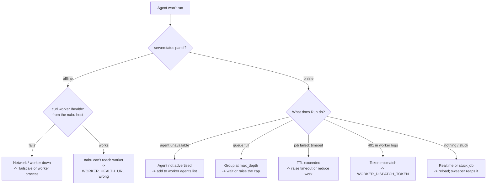

Agents run on a shared worker over the tailnet, so a failure could be in the
lesson, nabu, the network, or the worker. This page is **symptom-first**: find
what you're seeing, confirm the cause, apply the fix. The golden rule is *isolate
the layer* — don't guess, prove which hop is broken.

For how the pieces fit together, read [agent fundamentals](help:reference#agent-fundamentals) first.

## Decision tree



## Your visibility tools

Before diving in, know where the truth lives:

- **The `serverstatus` widget** (a `t="serverstatus"` shortcode in a lesson) — the
  student-facing health of the worker + their group tag. Green/offline in ~5s.
- **The teacher dashboard** (`/teacher/queues`, or `/admin/queues` for admins) —
  live histogram of jobs in flight per group, with each group's cap. This is how
  you *see* queue pressure and timeouts across a course.
- **`job_events`** — the per-job event stream (`queued → running → complete`, or a
  `timeout` / `fail` event). Visible in the PocketBase dashboard at `/_/` and to
  the job's owner/staff via the API.
- **`loopback-test.sh`** — proves the worker + auth without any network (below).

## Symptoms

### "The agent server is offline"

The `serverstatus` widget is red, or Run shows the offline banner. Isolate the hop:

1. **Prove the worker itself.** On the worker host:
   `curl -s http://127.0.0.1:8091/healthz` → expect JSON. If this fails, the
   worker process is down or crashed — restart it and check its logs.
2. **Prove the network.** From the **nabu** host:
   `curl -s http://sa-worker:8091/healthz`. If step 1 worked but this fails, it's
   the tailnet — check the Tailscale ACL (`tag:server → tag:worker:8091`), that the
   worker binds a tailnet address (`WORKER_ADDR=0.0.0.0:8091`, not `127.0.0.1`),
   and MagicDNS. See `tailscale/hosts.md` (not yet in this repo).
3. **Prove nabu's config.** If both curls work but the widget is still offline,
   nabu's `WORKER_HEALTH_URL` is wrong or unset — nabu reports "no worker
   configured". Fix the env and restart.

nabu caches health for ~3s, so allow a few seconds after a fix.

### ni6 service won't start: "node not installed" (but node works in your shell)

`journalctl -u ni6` shows the pre-flight failing on `FAIL node … not found`, yet
`node --version` works fine when *you* run it. This is a **service-user PATH**
problem, not a missing runtime. The service runs as the unprivileged `ni6` user
with a minimal, non-login `PATH`; a Node installed under **your** home
(`/home/you/.nvm`, via nvm) is invisible to it. Two fixes, in order of likelihood:

1. **Node was never installed for the service user.** Install it as `ni6`, which
   the unit's `NVM_DIR=/opt/ni6/.nvm` then resolves:

   ```bash
   NVM_TAG=$(curl -fsS https://api.github.com/repos/nvm-sh/nvm/releases/latest | sed -n 's/.*"tag_name": *"\([^"]*\)".*/\1/p')
   sudo -u ni6 -H bash -c "curl -o- https://raw.githubusercontent.com/nvm-sh/nvm/$NVM_TAG/install.sh | bash \
       && . /opt/ni6/.nvm/nvm.sh && nvm install 22 && nvm alias default 22"
   sudo systemctl restart ni6
   ```

   Never "fix" this by installing Node as root — the worker runs an npm tree and
   agent steps and must stay unprivileged. See
   [Making it durable](help:reference#agent-deploy).

2. **The journal shows the OLD message text.** If the wording doesn't match the
   current `start.sh` (not yet in this repo) (e.g. it still says "not installed
   — ni6 needs Node 22.x" with no nvm mention), the deployed `/opt/ni6/start.sh`
   is **stale** — systemd is running an old copy. Running `start.sh` from your
   checkout warns `deploy drift` and refuses the service path for this reason; sync
   it with the `sudo cp …` line it prints, then restart. After that, run
   `/opt/ni6/start.sh --check` to confirm a clean pre-flight.

### "Agent unavailable"

Run is refused with `agent_unavailable`. The worker is up but doesn't advertise
that agent. Check `/healthz` `agents[]`: the `agent:` value in the slide's
`t_agent` must appear there. Fix by advertising it in
[worker/main.go](../../../cmd/nabu-worker/main.go) (the `agents` list +
a `runAgent` branch). A typo in the lesson's `agent:` is the usual cause.

### "Your group's queue is full"

A `429 queue_full` — the group has `max_depth` jobs already queued/running. This
is the system protecting the worker, not a bug. Options:

- **Wait** — the bar on the teacher dashboard drains as jobs finish.
- **Raise the cap** for that group (teacher), or lower course-wide concurrency.
- If the dashboard shows a group **stuck at its cap with nothing finishing**, the
  jobs are wedged — see "stuck jobs" below.

### "Job failed — timed out"

The job ran past its TTL. In `job_events` you'll see a `timeout` event (distinct
from a plain `fail`). The TTL is the slide's `t_agent.timeout`, clamped to
`[5s, AGENT_MAX_TTL]` (default max 120s). Fixes:

- The work genuinely needs longer → raise the slide's `timeout`, or raise the
  ceiling with `AGENT_MAX_TTL` for a heavier course.
- Lots of timeouts on the dashboard for a big course → the worker is overloaded;
  reduce concurrency (lower `max_depth`) rather than just extending TTLs.

### Worker logs show "dispatch rejected: bad or missing token"

nabu got a `401` from the worker. The bearer secrets don't match:
`WORKER_DISPATCH_TOKEN` must be the **same value** on nabu and the worker (both
from Infisical). Regenerate once, set on both, restart. Never commit or log it.

### `tailscale up` says "requested tags are invalid or not permitted"

The full error is `Authorization failed / requested tags [tag:worker] are invalid
or not permitted`. The `:` in `tag:worker` is correct syntax — that isn't the
problem. One of two things is:

- **The ACL policy hasn't been applied to the tailnet.** Tailscale validates tags
  against the policy on its coordination server, not against
  `acl.hujson` in this repo. Paste that file into
  [Access controls](https://login.tailscale.com/admin/acls) and save, *then* run
  `tailscale up`. This is the usual cause on a fresh tailnet.
- **Your login isn't a tag owner.** `acl.hujson` gives all three tags to
  `autogroup:admin` — Owner, Admin, or Network-admin only. Signing in as a plain
  member produces the identical error even with the policy applied. Either raise
  your role, or replace `autogroup:admin` with your login in `tagOwners`.

Full walkthrough: [the tailnet setup](help:reference#agent-deploy).

### Infisical says your session is "being overwritten by the INFISICAL_TOKEN environment variable"

You never set `INFISICAL_TOKEN`, and that's the confusing part. The Infisical CLI
also reads a **bare `$TOKEN`** from the environment and treats it as its own auth
token, but reports the problem using the documented variable name.

The usual source is a shell where you exported a dispatch token by hand. Fix:

```bash
echo "${TOKEN:+set}"   # prints "set" if a stray TOKEN is present
unset TOKEN            # infisical uses your logged-in session again
```

This is why the [deploy runbook](help:reference#agent-deploy) calls the local
dispatch secret `LOCAL_TOKEN` and not `TOKEN`. Keep any shell variable you export
during bring-up specific — a generic name will eventually be consumed by a tool
that binds its own flags to the environment.

### "Tailscale SSH enabled, but access controls don't allow anyone to access this device"

**Ignore this one.** It appears after an otherwise successful `tailscale up --ssh`
and concerns *operator SSH only*. It has no bearing on the nabu → worker path,
which is enforced by the `acls` block on port `8091`, not the `ssh` block. No gate
in the [deploy runbook](help:reference#agent-deploy) requires Tailscale SSH.

To confirm your ACL is genuinely working while this warning shows, test the
boundary that matters — from the **worker**, the server must be unreachable:

```bash
timeout 8 curl -s -o /dev/null telnet://<nabu-node-name>:22 \
  || echo "blocked — correct, worker initiates nothing"
```

If you do want operator SSH, inspect what actually compiled for the node:

```bash
sudo tailscale debug netmap | grep -A5 -i sshpolicy
```

`"rules": []` means no `ssh` rule resolved to a usable principal for this device.
An `autogroup:` source can produce this; an explicit login (`["you@nabu.example"]`)
in the `ssh` block's `src` is the most reliable form. Dropping `--ssh` from the
join command removes the warning entirely.

### The widget hangs on "queued"/"running" and never updates

Almost always the realtime update was missed, not a stuck job:

- **Reload the page.** The widget re-reads the job on mount (`getOne` reconcile),
  so a reload shows the true state.
- If it's genuinely stuck `running`, the **sweeper** fails it at
  `dispatched_at + ttl + grace` and a restart's **reconciler** fails any job left
  in flight — so a stuck job frees its quota on its own within the TTL window. If
  it doesn't, check the nabu logs for the sweeper and confirm `dispatched_at` and
  `timeout_s` are set on the job in `/_/`.

## Test the worker + auth with zero network

Before blaming the tailnet, prove the worker and its auth on loopback:

```bash
./secret-agent-glue/scripts/loopback-test.sh
```

It builds the worker, starts it on `127.0.0.1` with a token, and asserts: health
is open, dispatch rejects a missing/wrong token (`401`), and the correct token
runs the job. All green ⇒ the worker and auth are fine and any remaining problem
is the **network/ACL** or **nabu's config** — not the worker. Loopback can't
exercise the Tailscale ACL itself; that needs two tailnet nodes (see
`tailscale/hosts.md` (not yet in this repo)).

## Golden rules

- **Isolate the layer.** worker `/healthz` locally → then from nabu's host → then
  nabu's config. Each curl rules a layer in or out.
- **Read `job_events`.** `queued/running/complete` vs `timeout` vs `fail` tells you
  what actually happened, per job.
- **Watch the dashboard for patterns.** One timeout is a job; a wall of them is a
  capacity problem — tune `max_depth` / `AGENT_MAX_TTL`, don't chase individual jobs.
