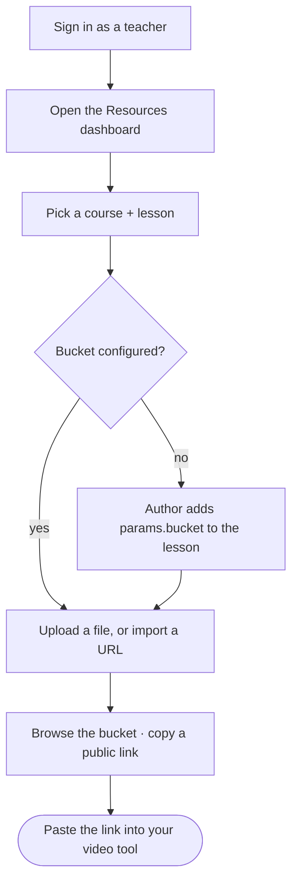

Every lesson can have a **resource bucket** — cloud storage for the documents and
videos that lesson uses. This page walks a teacher from signing in to a working
public link, and explains the bucket view. You never handle storage keys: nabu
does all of that for you.

## The journey at a glance



## Before you start

- You're signed in as a **teacher** (or admin). The **Resources** link only appears
  in the top nav for staff.
- The lesson has a **bucket** configured. If it doesn't, the dashboard tells you so
  (see "Configuring a lesson's bucket" below).

## 1 · Open the Resources dashboard

Sign in, then click **Resources** in the top navigation. This opens the resources
dashboard for teachers. (If you don't see the link, your account isn't a teacher —
ask an admin.)

## 2 · Pick a course and lesson

Use the two dropdowns at the top: choose a **course**, then a **lesson** within it.
Everything on the page — the uploader, the file list, and the usage figure — is
scoped to the lesson you pick. Switching lessons switches the bucket you're looking
at.

Under the choosers you'll see the lesson's **bucket** name and prefix, and a note
that uploads land under `resources/`.

## 3 · Add a resource

There are two ways to add a resource. Both end with the file living in the lesson's
bucket at a **public URL**.

- **From your machine** — choose a file and press **Upload**. The file goes straight
  from your browser to the bucket (nabu hands your browser a one-time, time-limited
  upload link; it never sees your file's bytes). Good for files you have locally.
- **From a URL** — paste a link and press **Import**. nabu fetches that URL on the
  server and stores a copy in the bucket. Good for something already online.

While it works you'll see a spinner; on success a short confirmation. The new file
appears in the list below.

> Filenames are cleaned up automatically (spaces and odd characters become `-`), so
> what you see in the list may differ slightly from your original name.

## 4 · Browse the bucket

The **Resources** panel lists everything in the lesson's bucket:

- **Name**, **Size**, and **Modified** time for each file.
- An **open** icon to view the file in a new tab.
- A **copy** icon to copy the file's **public URL** to your clipboard.

Press **Refresh** to re-read the bucket (it also refreshes automatically after an
upload). An empty lesson shows "No resources yet."

## 5 · Use a public link

Click the **copy** icon next to a file to copy its public URL. That URL is
world-readable by design, so you can paste it straight into a third-party video or
editing tool — no login, no key, no expiry. The same URL is what the file's **open**
icon points to.

## The bucket-usage figure

Top-right of the chooser is a small **usage** readout: the total **size** and
**number of files** in this lesson's bucket. It's how you keep an eye on how much a
lesson is storing — useful as course sizes grow. It refreshes when you change lesson
or after an upload (and is briefly cached, so a just-uploaded file may take a moment
to be reflected).

## Configuring a lesson's bucket

If the dashboard says *"This lesson has no resource bucket"*, an author/admin needs
to add it to the lesson's `_index.md` frontmatter — the teacher UI reads it from
there:

```yaml
---
title: "…"
params:
  bucket: my-lesson-bucket      # the storage bucket for this lesson
  prefix: rise-summer/my-lesson # optional key prefix inside the bucket
---
```

See [frontmatter authoring](help:authoring-lessons#frontmatter). The bucket and
its keys/policies are provisioned once per deployment — that's an ops task covered
in `docs/secrets.md`.

## What's happening behind the scenes

- nabu holds the **single** storage credential; you never see or handle it.
- Uploads use a **presigned link** — your browser talks to storage directly, for a
  few minutes only, for the exact file nabu named.
- The **bucket and folder** come from the lesson itself, so you can't upload to the
  wrong place.
- Files land under the lesson's `resources/` folder and are served at a **public
  URL** for external tools.

## If something goes wrong

- **"s3 not configured" / uploads all fail** — the deployment hasn't been given its
  storage keys yet, or the lesson has no bucket. Tell your admin; see
  `docs/secrets.md`.
- **The file uploads but the link won't open in another tool** — the bucket's
  public-read policy may not be set (a one-time bucket-config step; see
  `docs/secrets.md`).
- **Uploads fail with a CORS error in the browser console** — the bucket's CORS
  policy hasn't been applied. An admin runs this once per bucket:
  `infisical run --env prod -- nabu admin s3 set-cors --bucket <bucket>`.
- **A big video won't import from a URL** — URL import has a size cap; upload large
  media directly from your machine instead.
